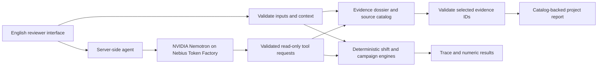

# Architecture and use of NVIDIA/Nebius

## Boundaries

- React/TypeScript render the interface. Vinext/Vite and Worker-compatible routes execute server requests.
- `src/lib/shift-lab.ts` computes generic directly charged LHD operation at a one-minute step.
- `src/lib/shift-campaign.ts` carries individual battery inventory through two shifts and one finite managed charging break.
- `src/lib/project-review.ts` filters evidence by technology, stage and jurisdiction; declared references are not verified documents.
- `src/lib/mining-agent.ts` manages the live Token Factory tool exchange. The exact configured model is reported with each real response.
- `src/lib/project-report.ts` validates model-selected IDs and fills project claims/counts from the catalog. JSON format does not itself prove correctness.
- `src/lib/project-knowledge-en.ts` provides English translations with identical reference IDs and source URLs.
- `app/demo` is the English judge-facing route. Spanish legacy modules remain available but are outside the primary demo walkthrough.

The project dossier uses two evidence tools and a structured selection. The lab can call comparison, scenario and continuity tools. Neither path controls equipment. There is no training pipeline, remote sensor connection, unified site power-flow engine or guaranteed optimal infrastructure search.

The API key remains server-side in an ignored local configuration or hosted secret. Integration receipts contain model IDs, tool results, usage and timestamps, never the credential.
